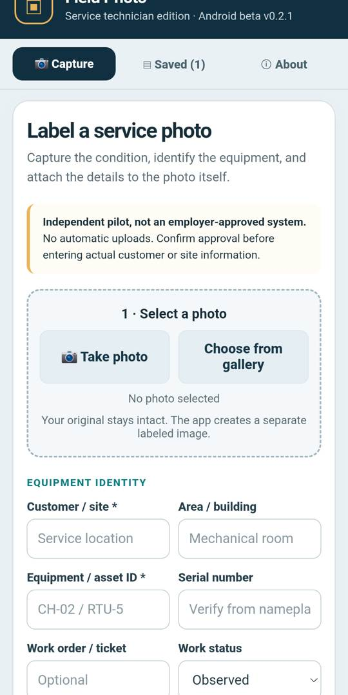
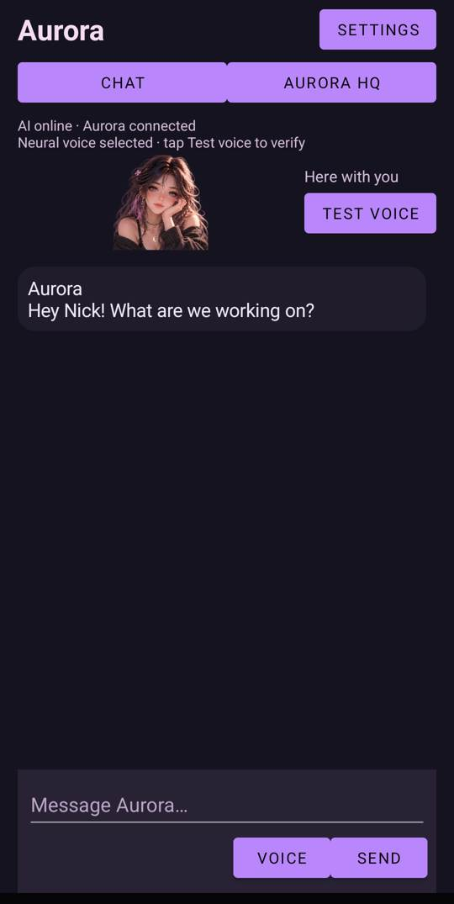
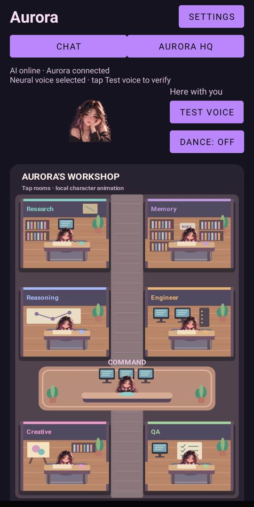

# Nicholas "Nick" Hodgkin

**Senior journeyman HVAC/R and hyperscale data-center chiller technician · Veteran · AI-assisted builder**

I work on industrial equipment for a living. I build software because the people closest to a problem often know exactly what a useful tool should do, even when they do not have a traditional programming background.

My work explores how **Codex and other AI-assisted development tools** can help turn technician problems into testable software. This is the public showcase for projects whose development repositories remain private.

**[Watch my 44-second introduction](https://drive.google.com/file/d/11X84cC6pzqelmT_o6F3zL_AXZ-I8SGWY/view)** · **[Connect on LinkedIn](https://www.linkedin.com/in/nicholas-hodgkin)**

> **Reviewer note:** These are genuine development-stage prototypes, not production releases. The screenshots below were captured from my Android phone on November 1, 2026. Code, credentials, employer/client information, and non-public operational material have intentionally not been published.

---

## 1. Field Photo: documentation built for technicians

**Android beta · On-device photo labeling · Offline-oriented workflow**

Field Photo helps a technician capture an equipment photo, label it with context such as asset identity and work status, and export a separate annotated image for handoff. The original photo remains intact. Its design is shaped by actual field constraints: gloves, inconsistent signal, high-volume documentation, and the need for minimal taps.

- **Built/implemented:** Android beta with photo selection, metadata labels, saved records, and JPEG export/share flows.
- **Verified:** App is installed and opens on a physical Samsung device; the image above shows the actual capture interface.
- **Not claimed:** Employer approval, production deployment, automatic uploads, or completed device QA across every workflow.

**[Field Photo project notes](docs/field-photo.md)**

## 2. Aurora: an expressive Android AI assistant

**Android prototype · Companion UI · Visual multi-agent workspace**

  
  

Aurora combines a conversational assistant with a character presence, voice experiments, and a visual HQ for different kinds of work. The design emphasizes permission-scoped AI calls and local handling for predictable animations and interface interactions.

- **Verified:** The Chat and Aurora HQ screens above were captured from the installed Android prototype.
- **In development:** Voice behavior, character motion, overlay interactions, usability, and build reliability.
- **Not claimed:** Fully autonomous self-improvement, release readiness, or complete validation of every phone interaction.

**[Aurora project notes](docs/aurora.md)**

## 3. DreamWorld Pocket Lab: learning through game prototypes

**Roblox development pipeline · Iterative playtesting · Honest failure reports**

DreamWorld is an Android-first Roblox game development and playtesting experiment. Earlier published versions were tested and found wanting. A later playability rebuild was prepared as a candidate, **not** represented as an approved or published release.

The useful lesson is not that every AI-assisted build immediately works. It is that prototype, device-test, failure log, and revision form a repeatable loop.

**[DreamWorld development notes](docs/dreamworld.md)**

## 4. Praxis: technician-first field workflow prototypes

**Field documentation · QA/checklist research · Training workflows**

Praxis explores a technician-focused toolkit for orientation, documentation, photos, site workflows, and practical learning. Some preview systems are intentionally access-restricted; this public summary does **not** grant access to company systems or expose client data.

**[Praxis overview](docs/praxis.md)**

## 5. RIFT: a research and verification approach

RIFT is a developing framework for using AI to gather evidence, flag uncertainty, cross-check technical references, and preserve research provenance. One application is chiller teardown and training material in Praxis Chiller Academy.

**[RIFT overview](docs/rift.md)**

---

## Why I'm sharing this

**My proposed Codex Ambassador audience:** skilled tradespeople, industrial HVAC/R workers, apprentices, critical-facilities personnel, and other builders who know their domain deeply but may not know how to code.

The method I want to share:

1. Start with a real operational problem and define what would count as useful.
2. Use Codex/AI-assisted development to build a narrowly scoped prototype.
3. Test on actual devices and in realistic, approved conditions.
4. Record failures and limitations as carefully as successes.
5. Publish a reproducible lesson others can adapt.

**My first proposed contribution:** a short, practical walkthrough of the Field Photo workflow, showing the real problem, Android prototype, constraints tested, and what remains unfinished.

### Transparency and access

- **This profile and the documents/screenshots here are public** for reviewers and learners.
- **Original development repositories remain private** to protect unfinished work, credentials, and potentially sensitive context.
- Describing a project as AI-assisted does not by itself establish exactly which commits or assets were produced by Codex. I will distinguish verified tool usage from broader AI experimentation in detailed demonstrations.
- The tools shown here are independent development work, not manufacturer, employer, or customer-approved field systems.

[Introduction video](https://drive.google.com/file/d/11X84cC6pzqelmT_o6F3zL_AXZ-I8SGWY/view) · [LinkedIn](https://www.linkedin.com/in/nicholas-hodgkin)
