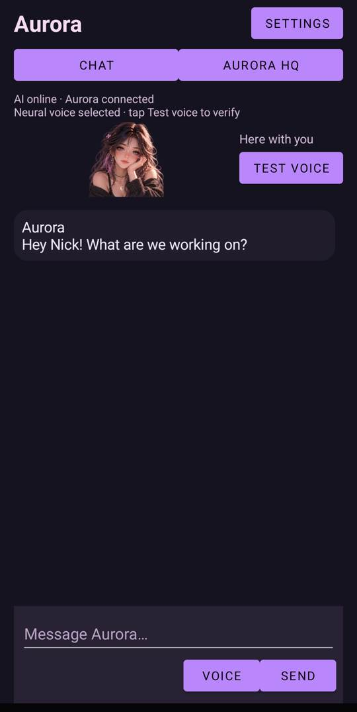
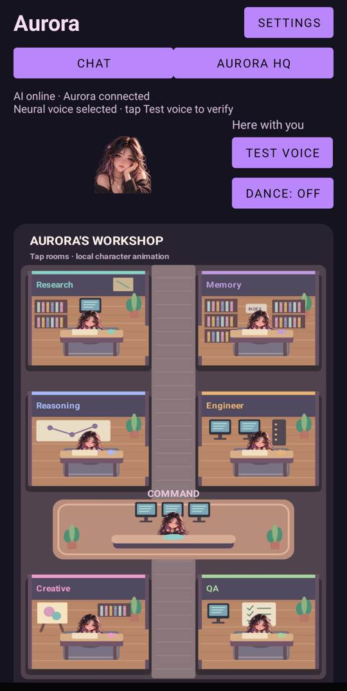

# Aurora | Android assistant prototype

  
  

## Concept
Aurora explores an assistant that combines practical conversation with expressive on-screen presence: a character that can respond, a small overlay experience, and a visual HQ organized around different tasks.

## Demonstrated
These screenshots were taken from the **installed Android app**, not from concept art:
- Chat interface with a character illustration and voice controls.
- Aurora HQ workshop showing themed rooms for research, memory, reasoning, engineering, creative work and QA.

## Development focus
- Character movement and interface-safe overlay interactions.
- Voice input/output and conversational behavior.
- Permission-scoped backend calls and locally deterministic visual behavior.
- Local memory and privacy-conscious controls.
- Consistent Android build, test, update and battery behavior.

## Current limitations
Aurora is **pre-release**. A rendered screen is not proof that hands-free speech, overlays, memory, wake words, or all permissions behave correctly on every device. Work and testing continue on a private development branch.

**What this shows about building with AI:** integrating many small components is different from generating a single demo screen. Testing, repair loops, and human oversight matter.

[← Portfolio](../README.md)
