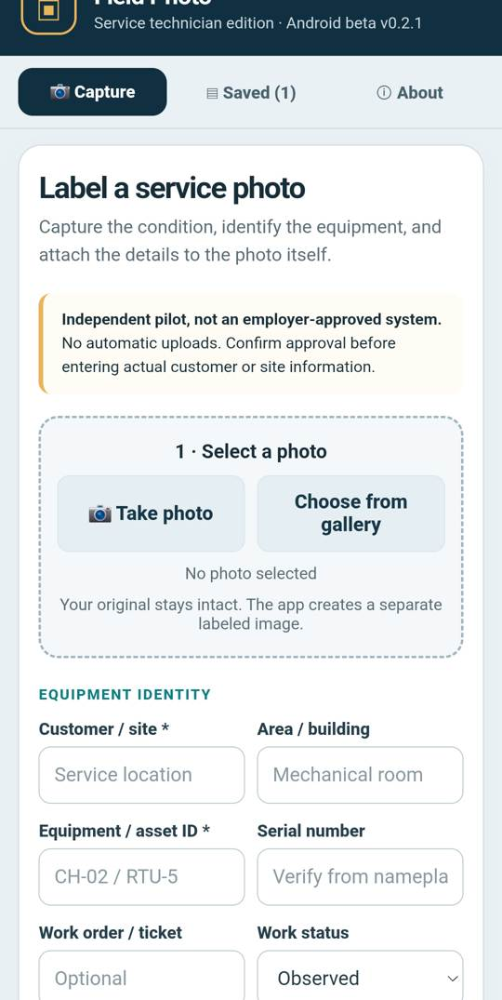

# Field Photo | Android technician documentation beta

## Why it exists
Equipment service documentation often lacks context. A photo by itself may not tell a receiving technician what asset it shows, what work status it represents, or where it belongs.

Field Photo is an **independent prototype** for stamping labels and metadata onto a separate JPEG, allowing context to travel with the image.

## Prototype capabilities
- Android capture / gallery workflow and a context-labeling UI.
- Equipment ID, location, status, ticket and related details as applicable.
- Saved local records and exported labeled JPEGs.
- Android share/export using device-native features.
- Offline-first local handling; no promised cloud sync or automated job record creation.

## Grounded test status
A screenshot of the app running on a physical Samsung Galaxy device was captured in November 2026. A verified beta build and further device testing have been part of development; a successful app launch alone does not prove every capture/export/storage path works in all conditions.

## What I'd demonstrate for Codex
1. Define the minimum metadata needed for a photo handoff.
2. Use AI-assisted development to implement a simple field interface.
3. Test with synthetic data, with and without connectivity.
4. Document failures and improvements, especially gallery export and usability.
5. Share a repeatable development exercise for non-programmers.

**Restrictions:** No customer records, employer IP, production work orders, or restricted jobsite photography are published. No employer approval is implied.

[← Portfolio](../README.md)
